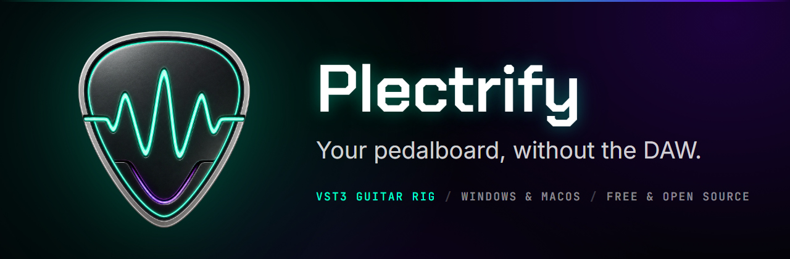
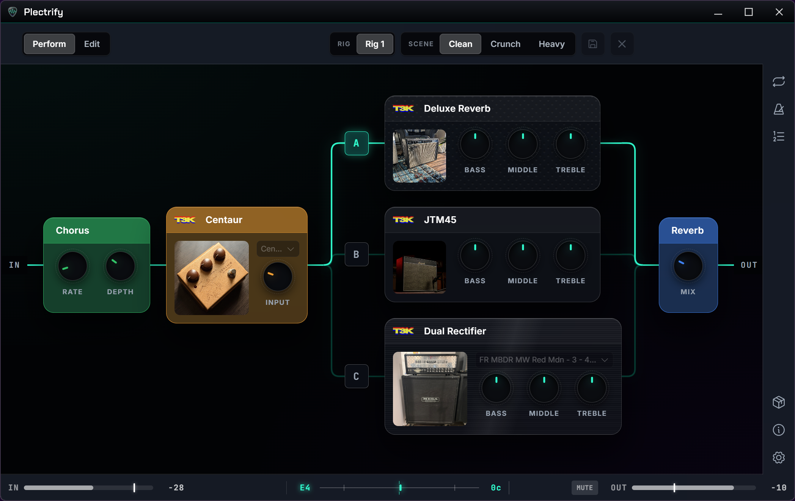

<!-- The masthead is one rendered image rather than a stack of centred lines:
     icon, name and tagline are a single composition, set in the product's own
     type, and it is the composition that is centred. Built by
     Assets/SocialPreview.html at ?h=420, the same source as the social card,
     so the page and the link unfurl cannot drift apart. -->

<!-- GitHub renders a lone image as a bare <a>, not wrapped in a 
, so it
     carries no bottom margin and the buttons butt straight against the artwork.
     These  s are the gap. vspace on the img would be the tidier answer but
     the HTML sanitizer strips it, as it strips style. -->
 
 

&nbsp;

&nbsp;

[Website](https://plectrify.com) ·
[Docs](https://plectrify.com/docs) ·
[Discord](https://discord.gg/dxQBanJr2X)

<!-- The hero shot: full width and flush left, like everything else on this
     page. A centred hero would put the one centred element directly under a
     left-aligned masthead.

     One image, not a <picture> pair. The app has a light theme too, but the
     shot is of the dark one and a <source media="(prefers-color-scheme: light)">
     needs a second file to point at; add Assets/screenshot-rack-light.png and
     the two <source> lines together if that shot is ever taken. -->

---

A free guitar rig for Windows, macOS and Linux. Plug in and play through your own
VST3 amp sims and pedals. No DAW, no session to set up.

Reorder, bypass and swap modules like pedals on a board. It runs live, at the
lowest latency your interface can do.

## What you get

<!-- TONE3000's own wordmark, verbatim from ui/src/lib/assets/tone3000/ and
     padded to a common canvas so both variants render at one width. Their rules:
     the full logo before the compact T3K mark, never recoloured or redrawn. It
     is pure red/blue/yellow on nothing, drawn for a dark ground, so light-theme
     readers get the -plate copy (the same near-black chip Tone3000Logo.svelte
     draws) rather than a tweaked logo. -->

- **Your plugins, any order.** Any VST3 amp or effect, from any maker, in any
  chain: a free overdrive into a commercial amp sim into whatever reverb you
  love.
- **Thousands of real amp captures.** Browse the
  <a href="https://www.tone3000.com"><picture>
  <source media="(prefers-color-scheme: light)" srcset="Assets/tone3000-logo-plate.svg">
  
  </picture></a>
  library and load a capture without leaving the app.
- **Two amps at once.** Split the chain into parallel paths, each with its own
  volume, pan, mute and solo, and merge them back.
- **Only the controls you use.** Map the few knobs you actually reach for onto
  the module card and hide the rest. Save the layout as a patch and reuse it.
- **Save and recall.** Save whole rigs (chain, routing, every plugin's exact
  settings). Your last session restores on launch.
- **Practice tools.** Tuner, metronome with tap tempo, and a looper, all built
  in.
- **Ready for the stage.** Setlists load a rig per song; scenes, MIDI learn and
  a stage view run the set from a footswitch.
- **Yours, with nothing attached.** Free and open source. No account, no DRM,
  no iLok, no telemetry. It phones home only for an anonymous update check.

## Install

Grab the latest installer from the
[releases page](https://github.com/patrickiel/plectrify/releases):

- **Windows 10/11 (64-bit):** run `Plectrify-win-x64-setup.exe`.
  Everything it needs is bundled.
- **macOS (Apple Silicon, 13.3+):** run `Plectrify-macos-arm64.pkg`.
  It installs the app plus the VST3 and AU plugins.
- **Linux (x86-64; Ubuntu 24.04, Debian 13 or newer):** install
  `Plectrify-linux-x64.deb`, e.g.
  `sudo apt install ./Plectrify-linux-x64.deb`.

> [!IMPORTANT]
> The macOS build is signed but **not notarized**, so macOS blocks the
> installer at first and may claim it *"is damaged"*. It isn't: go to
> **System Settings → Privacy & Security → Open Anyway**, or see the
> [full instructions](https://plectrify.com/docs/opening-on-macos). Every
> installer ships with a SHA-256 checksum you can verify.

Bring your own VST3 plugins; plenty of great ones are free.
[Neural Amp Modeler](https://www.neuralampmodeler.com) is included, so TONE3000
captures play with nothing else installed. On Windows, install your interface's
ASIO driver for the lowest latency; macOS uses CoreAudio; on Linux pick JACK
(PipeWire's JACK works) over ALSA.

## First five minutes

1. Open **Audio Settings** and pick your interface as input (the ASIO device
   type on Windows, JACK on Linux) and your speakers or headphones as output. The first
   enabled input channel is your guitar.
2. Hit **Scan Plugins** once. Plectrify finds and remembers your VST3s.
3. Add modules: an amp sim, then whatever effects you like. Drag to reorder,
   click to bypass, open a plugin's own editor from its card.
4. Map the knobs you care about, save the rig, play.

The [docs](https://plectrify.com/docs) go into more detail.

## Feedback and bugs

Open an [issue](https://github.com/patrickiel/plectrify/issues) or say hi on
[Discord](https://discord.gg/dxQBanJr2X). For bugs the fastest route is in the
app: **Report a bug** opens GitHub's form pre-filled with an environment report
(build, machine, audio device, plugin chain, never rig names or file paths).

## For developers

Plectrify is a JUCE 8 (C++17) app hosting VST3s, with the entire UI a Svelte 5
web app in an embedded web view.

- [CONTRIBUTING.md](CONTRIBUTING.md) build, run and test from source
- [AGENTS.md](AGENTS.md) architecture and repository layout in depth
- [RELEASING.md](RELEASING.md) how installers are built and published
- [SECURITY.md](SECURITY.md) what to report privately, and where

## Licence

Free software under the
[GNU Affero General Public License, version 3](LICENSE). Every release ships a
checksummed source archive of the exact Plectrify and patched JUCE code it was
built from.
